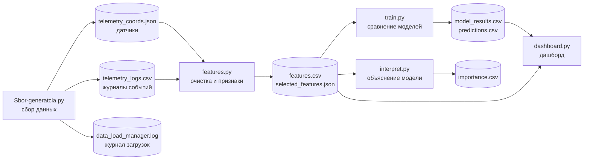

# Прогнозирование пробега и расхода топлива автопарка на основе телеметрии

Проектная работа по дисциплине «Интеллектуальный анализ данных», вариант 25 «Автотранспортное предприятие».
Автор: <ФИО>, группа МПИ 26-4, Институт компьютерных наук, НИТУ «МИСиС».

## Что это за система

Система прогнозирует суточный пробег (`distance_km`, км) и суточный расход топлива (`fuel_l`, л) парка из трёх грузовиков.
Она сама собирает данные из двух источников, очищает их, строит признаки, обучает и сравнивает модели,
объясняет их решения и показывает результат на дашборде.

Пользователь системы: диспетчер или логист автотранспортного предприятия. Ему нужно планировать закупку топлива
и понимать, насколько можно доверять прогнозу.

Данные синтетические (персональных данных нет). Грузовики работают по рабочим часам: в будни длинная смена,
в выходные короткая. Границы смены каждый день немного меняются, поэтому суточные значения не одинаковы.

## Архитектура



Слои хранения: сырые данные (`telemetry_*`), обработанные данные (`features.csv`), результаты моделей
(`model_results.csv`, `predictions.csv`). Все настройки лежат в `config.json`.

## Технологический стек

| Что | Чем | Почему |
|---|---|---|
| Язык | Python | Простой, много готовых библиотек для данных и машинного обучения |
| Данные | pandas | Работа с таблицами и временными рядами |
| Модели | scikit-learn | Готовые модели разных классов, проверка по времени, важность признаков |
| Дашборд | Streamlit | Веб-интерфейс на чистом Python, без отдельного фронтенда |
| Хранение | JSON и CSV файлы | Просто, наглядно, не требует установки СУБД |

## Структура репозитория

| Файл | Назначение |
|---|---|
| `Sbor-generatcia.py` | Сбор данных из двух источников (датчики JSON и журналы CSV) |
| `features.py` | Очистка, суточная витрина, признаки, проверка утечки, разбиение по времени, отбор признаков |
| `train.py` | Обучение и сравнение моделей |
| `interpret.py` | Интерпретируемость модели (компонент по выбору) |
| `dashboard.py` | Дашборд |
| `run_all.py` | Запуск всего пайплайна одной командой |
| `config.json` | Настройки |
| `requirements.txt` | Список библиотек |
| `.gitignore` | Список файлов, которые не нужно загружать в репозиторий (данные и результаты) |

## Быстрый старт

Нужен Python 3.10 или новее.

1. Установить библиотеки:
   ```
   pip install -r requirements.txt
   ```
2. Запустить весь пайплайн (первичная загрузка истории за 180 дней, около минуты):
   ```
   python run_all.py 180
   ```
   Скрипт по очереди выполнит сбор данных, обработку, обучение моделей и расчёт интерпретации.
   Если один из шагов завершится ошибкой, дальше он не пойдёт.
3. Запустить дашборд:
   ```
   python -m streamlit run dashboard.py
   ```
   Страница откроется в браузере по адресу `http://localhost:8501`. Данные на ней обновляются раз в минуту.
   Остановить дашборд: Ctrl+C в терминале.

Шаги 2 и 3 можно выполнить одной командой с флагом `--dashboard`:
```
python run_all.py 180 --dashboard
```
Флаг необязателен. Он запускает дашборд после выполнения всех шагов пайплайна. Без флага `run_all.py` просто завершается,
а дашборд запускается отдельной командой: он работает постоянно (это веб-сервер), и его автоматический запуск
помешал бы запускать пайплайн по расписанию.

Типовые команды:

| Ситуация | Команда |
|---|---|
| Первый запуск на новом компьютере (после установки библиотек) | `python run_all.py 180 --dashboard` |
| Данные уже есть: догрузить один новый день, пересчитать всё и показать | `python run_all.py --dashboard` |
| Данные и результаты готовы, нужен только дашборд | `python -m streamlit run dashboard.py` |

Число 180 означает, сколько дней истории создать при первом запуске. Без числа догружается один новый день.

Шаги можно запускать и по отдельности, в таком порядке:
`python Sbor-generatcia.py 180`, `python features.py`, `python train.py`, `python interpret.py`.

Файлы с данными и результатами (`telemetry_coords.json`, `telemetry_logs.csv`, `features.csv`, `predictions.csv` и другие)
создаются при запуске и не хранятся в репозитории (см. `.gitignore`).

## Что делает каждый шаг

**Сбор данных (`Sbor-generatcia.py`).** Два разнородных источника: показания датчиков (JSON: скорость, пройденный путь,
расход топлива, координаты) и текстовые журналы событий (CSV).
- Инкрементальность: повторный запуск догружает только новые данные.
- Идемпотентность: значения считаются от грузовика и времени, поэтому повтор даёт тот же результат, а дубли не появляются.
- Устойчивость к сбоям: при недоступности источника до 3 попыток, затем остановка с сохранением собранного.
  Запись идёт через временный файл, поэтому файлы не портятся.
- Журнал загрузок: `data_load_manager.log` (время, уровень, период, число строк, статус).

**Обработка и признаки (`features.py`).**
- Очистка: дубли, пропуски, невозможные значения (скорость вне 0-150 км/ч, отрицательные пробег и расход).
  Аномальные события (резкое торможение, превышение скорости) остаются, это сигналы, а не ошибки.
- Суточная таблица: одна строка = один грузовик за один полный день.
- Признаки из прошлого: значения вчера и неделю назад, среднее за 7 дней, календарные признаки (день недели, выходной, месяц),
  признаки из журналов (число тревожных сообщений и событий по ключевым словам), кодирование грузовика (one-hot).
- Проверка отсутствия утечки целевой переменной: данные портятся начиная с дня X, и программа проверяет, что признаки дня X
  не изменились. Если изменились, она останавливается с ошибкой.
- Разбиение по времени: последние 30 дней идут на проверку, остальное на обучение. Случайное зерно фиксировано.
- Отбор признаков: убираются константы и почти одинаковые признаки, затем остаются признаки с важностью не ниже 1%.
  Отбор делается только по обучающей части. В итоге из 23 признаков остаётся 4: день недели, пробег неделю назад,
  пробег вчера и среднее за 7 дней.

**Модели (`train.py`).** Для каждой цели сравниваются пять моделей: две наивные («как вчера» (базовая) и «как неделю назад»),
Ridge, Random Forest и Gradient Boosting. Схема проверки одна для всех: кросс-проверка во времени на обучающей части
и итоговая проверка на последних 30 днях. Метрики: MAE и RMSE; ошибка также выражена в процентах от среднего значения.

**Дашборд (`dashboard.py`).** Факт и прогноз на одном графике, показатели качества (ошибка в км или литрах, в процентах,
выигрыш у базовой модели), таблица сравнения моделей. Фильтры: показатель, грузовик (или весь парк), период, модель.

**Интерпретируемость (`interpret.py`, компонент по выбору).** Объясняется модель Random Forest:
1. важность признаков двумя способами (встроенная в лес и перестановочная);
2. объяснение отдельного прогноза: вклад каждого признака для выбранного грузовика и даты;
3. зависимость прогноза от значения одного признака;
4. сравнение важности признаков в двух периодах.

Результаты видны на дашборде в блоке «Почему модель так решила».

## Настройки (`config.json`)

| Параметр | Значение по умолчанию | Что означает |
|---|---|---|
| `coords_file` | `telemetry_coords.json` | Файл с показаниями датчиков |
| `logs_file` | `telemetry_logs.csv` | Файл с журналами событий |
| `manager_log` | `data_load_manager.log` | Журнал загрузок |
| `step_minutes` | 10 | Шаг записи данных, минут |
| `default_start_time` | `2026-01-01 08:00:00` | С какого момента начинается история |
| `fail_chance` | 0.02 | Вероятность недоступности источника на одной попытке (имитация сбоев) |
| `max_retries` | 3 | Число попыток подключения |
| `trucks` | `TRUCK_001`, `TRUCK_002`, `TRUCK_003` | Список грузовиков |
| `max_speed_kmh` | 150 | Скорость выше этого значения считается ошибкой датчика |
| `valid_days` | 30 | Сколько последних дней идёт на проверку моделей |
| `random_seed` | 42 | Случайное зерно (воспроизводимость) |
| `features_file` | `features.csv` | Витрина признаков |
| `selected_features_file` | `selected_features.json` | Отобранные признаки по каждой цели |
| `results_file` | `model_results.csv` | Сравнение моделей |
| `predictions_file` | `predictions.csv` | Факт и прогнозы по дням |
| `importance_file` | `importance.csv` | Важность признаков |

## Результаты

На последних 30 днях (проверочная часть, со 2 июня по 1 июля 2026 года) средняя ошибка (MAE) по одному грузовику:

| Модель | Пробег, км | Расход, л |
|---|---|---|
| Наивный: как вчера (базовая) | 213.2 | 66.8 |
| Наивный: как неделю назад | 72.1 | 22.0 |
| Ridge | 70.4 | 22.1 |
| Random Forest | 62.7 | 19.5 |
| Gradient Boosting | 66.0 | 19.8 |

Лучшие модели ошибаются примерно на 7,6-7,7% от суточного значения и точнее базовой модели «как вчера» на 66-71%.
Относительно более сильного ориентира «как неделю назад» Random Forest точнее примерно на 11-13%.
Результаты кросс-проверки близки к итоговым (например, 64.7 и 62.7 км для Random Forest по пробегу), поэтому переобучения нет.
Для всего парка (сумма трёх грузовиков) относительная ошибка ниже, потому что ошибки отдельных грузовиков частично компенсируют друг друга.
Числа могут немного меняться при догрузке новых дней, так как сдвигается проверочный период.

## Ограничения

- Данные синтетические. Координаты и пробег генерируются независимо друг от друга: пробег не выводится из координат.
- Недельная закономерность в данных простая (будни и выходные), поэтому модели лишь ненамного точнее наивного прогноза «как неделю назад».
  Случайный сдвиг границ смены даёт шум, который не может угадать никакая модель.
- Прогноз строится на проверочный период (последние 30 дней), в котором известны факты. Прогноз на будущие дни не реализован.
- Объяснение отдельного прогноза упрощённое: вклад признака равен изменению прогноза при замене признака на типичное значение (медиану).
  Вклады показывают направление и силу влияния, но не обязаны точно складываться в итоговое число.
